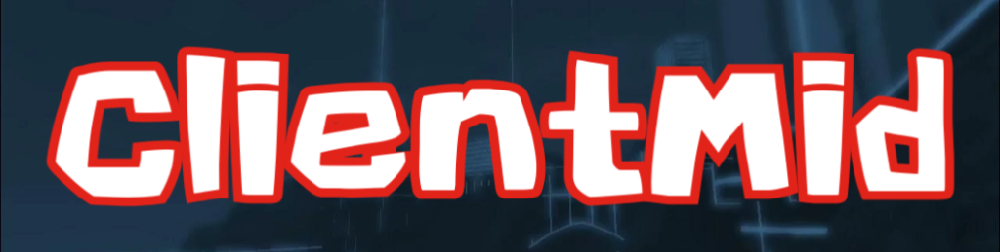

<div align="center">

[](https://cm.wiiblox.com)

<hr>

[](https://scriptblox.com/script/Universal-Script-clientMid-241059) [](https://github.com/clockersman/clientMid/stargazers)

<hr>

CLIENTMID is the cool 2016 client recreation! with configs and muany others! FOR EXECUTORS!

### Latest Loadstring (shortened)

<hr>

```lua
loadstring(game:HttpGet("https://raw.githubusercontent.com/clockersman/clientMid/refs/heads/main/Source/clientMid.lua"))()
```
<hr>

### Latest Loadstring (website version)

<hr>

```lua
--[[
                                                                               
           mmmm         ##                                   mmm  mmm     ##           mm 
           ""##         ""                           ##      ###  ###     ""           ## 
  m#####m    ##       ####      m####m   ##m####m  #######   ########   ####      m###m## 
 ##"    "    ##         ##     ##mmmm##  ##"   ##    ##      ## ## ##     ##     ##"  "## 
 ##          ##         ##     ##""""""  ##    ##    ##      ## "" ##     ##     ##    ## 
 "##mmmm#    ##mmm   mmm##mmm  "##mmmm#  ##    ##    ##mmm   ##    ##  mmm##mmm  "##mm### 
   """""      """"   """"""""    """""   ""    ""     """"   ""    ""  """"""""    """ "" 
                             

-- CLIENTMID is the cool 2016 client recreation! with configs and muany others! FOR EXECUTORS!

--]]

-- Set external config BEFORE loadstring so clientMid.lua picks it up via getgenv()
getgenv().ClientMidConfig = {
    Platform = "Desktop",
    
    -- opt
        
    Pre2022Materials = false,
    OldAnimations = false,
    OldCamera = false, --beta

    PluginRepos = {
        {
            Name = "Wiiblox",
            URL = "https://cm.wiiblox.com",
            Manifest = "plugins/manifest.lua",
            Download = "store_plugins/%s",
        },
    },

    -- topbar

    TopbarConstants = {
        --topbar shit

        Topbar_Bg_Color = Color3.fromRGB(31, 31, 31),
        Topbar_Bg_Transparency = 0.5, -- when set to 1, you can click outside the topbar frame (basically yay now i can click buttons that are underneath the topbar!! :D)

        -- playerlist
        Entry_Pad = 2,
        Bg_Transparency = 0.5,
        Bg_Color = Color3.fromRGB(31, 31, 31),
        Bg_Color_Top = Color3.fromRGB(106, 106, 106),
        Text_Stroke_Transparency = 0.75,
        Text_Color = Color3.fromRGB(255, 255, 243),
        Text_Stroke_Color = Color3.fromRGB(34, 34, 34),
        Tween_Time = 0.15,
        Max_Leaderstats = 4,
        Tile_Spacing = 2,
        Player_Entry_Size_Y = 24,
        Team_Entry_Size_Y = 18,
        Name_Entry_Size_X = 170,
        Stat_Entry_Size_X = 75,

        -- namehealth
        NameHealth_Width = 170,
        NameHealth_Font_Color = Color3.fromRGB(255, 255, 255),
        Health_Bg_Color = Color3.fromRGB(228, 236, 246),
        Health_Red = Color3.fromRGB(255, 28, 0),
        Health_Yellow = Color3.fromRGB(250, 235, 0),
        Health_Green = Color3.fromRGB(27, 252, 107),
        Health_Overlay_Threshold = 0.05,

        -- settingshub
        SettingsShield_Color = Color3.fromRGB(41, 41, 41),
        SettingsShield_Transparency = 0.2,
        HubBar_Width = 800,
        HubBar_Height = 60,
        HubBar_Y = 0,
        HubBar_Top_Pad = 6,
    },

    -- put the names you want disabled in the list below, e.g. "Chat", "Health" :3
    -- NOTE: they must be quoted strings like "Chat" (not bare Chat), and case matters (PlayerList!)
    -- Available: "Menu", "Chat", "Backpack", "Health", "Name", "PlayerList", "Topbar_Bg"
    TopbarDisabled = {
    },

    -- toggle chat in hotkey
    ChatToggle = {
        Enabled = true,
        KeyCode = Enum.KeyCode.X,
        OpenKeyCode = Enum.KeyCode.Slash,
    },
    
    -- backpack search
    BackpackThings = {
            Enabled = true,
            Keycode = Enum.KeyCode.Z,    
    },
    
    -- playerlist 

    BcOrRbxplus = "",

    -- world

    -- Players --

    --HELP! what to do here? use a option bellow :
    -- "Username", "Display"
    
    UsernameOrDisplay = "Display",
    ShowHealthBar = true,

    -- Chat
    ChatTeamIndicator = true,

    -- guest mode
    GuestMode = false,
    -- when true, a username like "Guest8827" or "Geust8827" becomes "Guest 8827";
    -- when false, the local player always gets a random Guest number
    UsernamePatch = false,

    Assets = {
	-- topbar

	DropShadow = "rbxassetid://134222197430023",
	DropShadow_2x = "rbxassetid://127753152532136",

	Hamburger = "rbxassetid://114784909514444",
	Hamburger_Down = "rbxassetid://88180197328772",
	Hamburger_2x = "rbxassetid://128119389870804",
	Hamburger_2x_Down = "rbxassetid://80245612797835",

	Chat = "rbxassetid://93389020466934",
	Chat_Down = "rbxassetid://115742044949430",
	Chat_2x = "rbxassetid://77093044424248",
	Chat_2x_Down = "rbxassetid://94887603706899",

	MessageCounter = "rbxassetid://71605582053442",
	MessageCounter_2x = "rbxassetid://126873557618054",
		Hurt_Overlay = "rbxassetid://34854607",
		HubBar_Bg = "rbxasset://textures/ui/Settings/MenuBarAssets/MenuBackground.png",
		HubBar_TabSelection = "rbxasset://textures/ui/Settings/MenuBarAssets/MenuSelection.png",
		Menu_Button = "rbxasset://textures/ui/Settings/MenuBarAssets/MenuButton.png",
		Menu_Button_Selected = "rbxasset://textures/ui/Settings/MenuBarAssets/MenuButtonSelected.png",
		Plugins_Icon = "rbxassetid://135302421041374",
		PlayersTab_Icon = "rbxasset://textures/ui/Settings/MenuBarIcons/PlayersTabIcon.png",
		GameSettingsTab_Icon = "rbxasset://textures/ui/Settings/MenuBarIcons/GameSettingsTab.png",
		ReportAbuseTab_Icon = "rbxasset://textures/ui/Settings/MenuBarIcons/ReportAbuseTab.png",
		HelpTab_Icon = "rbxasset://textures/ui/Settings/MenuBarIcons/HelpTab.png",
		RecordTab_Icon = "rbxasset://textures/ui/Settings/MenuBarIcons/RecordTab.png",
		Dialog_White = "rbxasset://textures/ui/dialog_white.png",
		Leave_Icon = "rbxasset://textures/ui/Settings/Help/LeaveIcon.png",
		Reset_Icon = "rbxasset://textures/ui/Settings/Help/ResetIcon.png",
		Resume_Icon = "rbxasset://textures/ui/Settings/Help/EscapeIcon.png",
	ChatIcon = "rbxasset://textures/ui/Chat/Chat.png",
	ChatIcon_Down = "rbxasset://textures/ui/Chat/ChatDown.png",

	ChatGear = "rbxassetid://86722145007462",
	ChatResizeCursor = "rbxassetid://90033267536542",


	-- mobile

	ToggleChat = "rbxassetid://98631025628185",
	ToggleChat_2x = "rbxassetid://111443998354758",
	ToggleChat_Down = "rbxassetid://122996640001417",
	ToggleChat_Down_2x = "rbxassetid://94583084853427",

	Backpack = "rbxassetid://136724106639985",
	Backpack_Down = "rbxassetid://136049039204582",
	Backpack_2x = "rbxassetid://122405406674970",
	Backpack_2x_Down = "rbxassetid://102902672569764",

	-- settings

	-- icons / playerlist

	BlockedIcon = "rbxassetid://132203770717188",
        AdminIcon_16 = "rbxassetid://93206064526439",

        -- playerlist
        Scroll_Bottom = "rbxasset://textures/ui/scroll-bottom.png",
        Scroll_Mid = "rbxasset://textures/ui/scroll-middle.png",
        Scroll_Top = "rbxasset://textures/ui/scroll-top.png",
        Icon_BC = "rbxasset://textures/ui/icon_BC-16.png",
        Icon_TBC = "rbxasset://textures/ui/icon_TBC-16.png",
        Icon_OBC = "rbxasset://textures/ui/icon_OBC-16.png",
        Icon_PlaceOwner = "rbxasset://textures/ui/icon_placeowner.png",
        PlayerList_BlockedIcon = "rbxasset://textures/ui/PlayerList/BlockedIcon.png",
        Friend_Icon = "rbxasset://textures/ui/icon_friends_16.png",
        Friend_Request_Icon = "rbxasset://textures/ui/icon_friendrequestsent_16.png",
        Friend_Received_Icon = "rbxasset://textures/ui/icon_friendrequestrecieved-16.png",
        Icon_Admin = "rbxassetid://93206064526439",-- for normal admin icon : rbxasset://textures/ui/icon_admin-16.png

        -- chat
        Chat_TeamButton = "rbxasset://textures/ui/chat_teamButton.png",
        Scroll_Bottom_Image = "rbxasset://textures/ui/scroll-bottom.png",
        Scroll_Middle_Image = "rbxasset://textures/ui/scroll-middle.png",
        Scroll_Top_Image = "rbxasset://textures/ui/scroll-top.png",
    }
}

loadstring(game:HttpGet("https://cm.wiiblox.com/clientMid.lua"))()
```

</div>

quite large ain't it?
